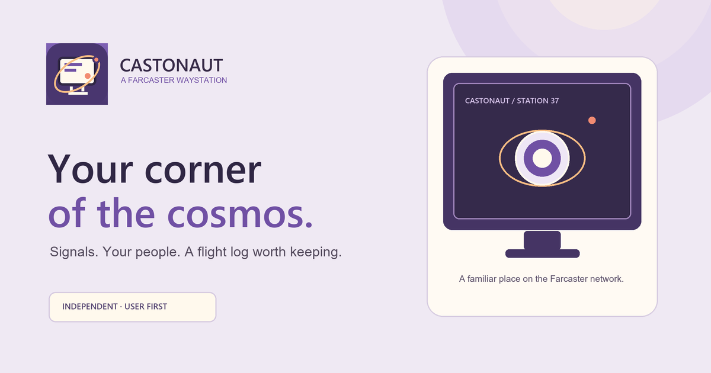
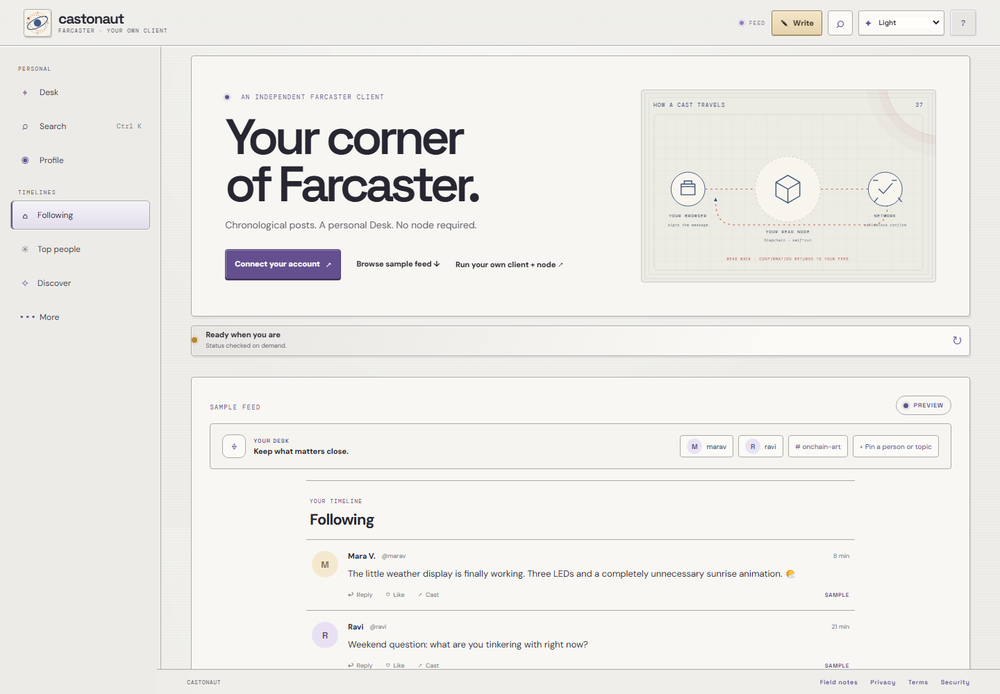
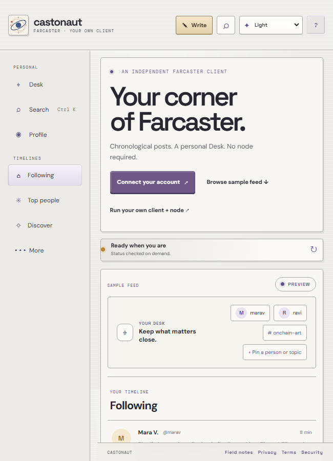
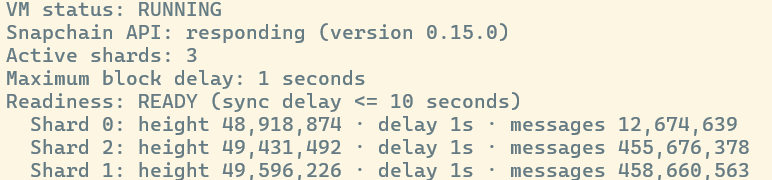

# Castonaut

<p align="center">
  
</p>

<p align="center">
  <a href="https://castonaut.vercel.app/"></a>
  <a href="LICENSE"></a>
  
</p>

**Catch up in time order. Keep your people and posts close.** Castonaut is an independent, open-source Farcaster client with a readable chronological feed and a personal Desk for the people, posts, and topics you want to find again. It pairs a calm desktop-inspired interface, familiar controls, and a little orbital character without getting between you and the conversation.

You can browse the hosted client without setting up a node or entering an API key. Bring an existing Farcaster account when you’re ready to follow, react, or post.

<p align="center">
  
</p>

<p align="center"><em>Explore a sample timeline and the read path before connecting an account. The people and posts shown here are sample content.</em></p>

### What runs where

```text
YOUR COMPUTER                     YOUR NODE                         VALIDATOR NETWORK
Castonaut client  ⇄  Snapchain read node  ⇄  Farcaster validators
feed · local Desk     stores state · serves API   decide blocks · replicate messages
signs actions         relays signed writes
```

The client and its personal Desk run in your browser. The read node runs on infrastructure you operate and follows network state; it does not vote or decide blocks. Validators run consensus. Castonaut reads through the node and verifies submitted social actions against network state.

## A familiar place for your Farcaster life

- **A feed you can follow:** read recent casts in chronological order, switch to Top people, or discover accounts through your follow graph. Posts keep replies, quoted casts, links, and media in context.
- **The Desk:** pin people, save casts, and collect topics into personal stacks. Desk data stays in this browser; it is not published to Farcaster or synced to another device.
- **Native social actions:** write casts and threads, reply, quote, like, recast, and follow from the client. Your actions use your Farcaster app signer and are public protocol activity.
- **Search with clear scope:** filter posts loaded in the current feed, open a person by exact username or FID, or load a channel timeline from the configured Snapchain node. Search does not require a Neynar search key or pretend to be a full-network text index.
- **Play & tools:** open the built-in games and Farcaster tools without turning the main timeline into a busy arcade.
- **A desktop-inspired interface:** light and dark moods, careful typography, compact status details, responsive navigation, and keyboard access for common actions.

<p align="center">
  
</p>

<p align="center"><em>A narrow-screen preview of the landing page and sample feed.</em></p>

<p align="center"></p>

<p align="center"><em>Example from an operated node: all three shards are current and readiness is READY. Heights and message counts advance over time; this is a captured example, not a live status page.</em></p>

## Run your own client and read node

The hosted preview is the fastest way to explore. To run the complete self-hosted path, first install Node.js 22, the Google Cloud CLI, and this repo’s dependencies with `npm ci`; sign in to a billing-enabled Google Cloud project and select it. Then these three commands provision a Snapchain read node, start it, and point your local Castonaut client at it:

```sh
npm run provision -- us-central1-a
npm run node -- us-central1-a
npm run client -- --zone us-central1-a
```

The node’s first sync can take hours. Check readiness with `npm run node:check -- us-central1-a` before relying on fresh data. A read node follows and serves network state; it does not vote on blocks. It can relay signed messages to validators, so Castonaut checks the message back against network state before showing it as confirmed. Read the [three-step quickstart](https://castonaut.vercel.app/tutorial.html#quickstart) for prerequisites, cost controls, account setup, and cleanup. For a hosted deployment, set `SNAPCHAIN_URL` as a server-side environment variable and check node readiness before inviting people to use it; never expose node credentials through a `VITE_` variable.

The commands are inspectable in the repository: [provisioning script](scripts/provision-gcp.mjs), [node startup script](scripts/start-node.mjs), and [read-only status script](scripts/node-status.mjs). The node readiness check is implemented in the startup script. See the [security guide](tutorial.html#security) before entering an account recovery phrase, and review the [MIT License](LICENSE).

### Why run your own Snapchain read node?

It gives your client a read path that you operate instead of making every feed request depend on a third-party data API. A Snapchain read node stores network state, serves the HTTP and gRPC APIs, and verifies decided blocks against validator commit certificates. Castonaut reads through that endpoint and confirms writes by reading them back after the network merges them. You can inspect readiness, shard heights, and sync delay with `npm run node:status`.

This is practical infrastructure ownership, not validator status: read nodes do not propose or vote on blocks, and a node that is behind can serve stale data. Casts, follows, and reactions remain public Farcaster protocol activity. In local mode, the node can also see your computer’s public egress IP. Keep the node current, set a cloud budget alert, and shut it down when you no longer need it. See Snapchain’s [node roles](https://snapchain.farcaster.xyz/node-types), [HTTP API](https://snapchain.farcaster.xyz/reference/httpapi/httpapi), and [official node guide](https://snapchain.farcaster.xyz/guides/running-a-node).

## Try Castonaut in three steps

1. **Browse.** Open [castonaut.vercel.app](https://castonaut.vercel.app/) and read the public sample feed.
2. **Connect when ready.** Use an existing Farcaster account’s recovery phrase to authorize a separate, limited app signer in this browser. The phrase is processed in the page and cleared after use; only continue on a deployment and device you trust. The app signer can perform social actions but cannot move funds. Review the account and authorization details before approving.
3. **Make it yours.** Follow people, personalize the feed, and keep useful people and posts on your Desk. Castonaut’s hosted node connection works out of the box; running your own node is optional.

“Forget this browser” removes the local signer key. It does not revoke the signer on Farcaster; revoke it separately in account settings when needed. The Desk, saved posts, drafts, filters, and preferences are local to this browser. Export a Desk backup before clearing browser data.

## Run Castonaut locally

Requires Node.js 22.

```sh
git clone https://github.com/wlplease/castonaut.git
cd castonaut
npm ci
npm run dev
```

The Vite preview uses Castonaut’s hosted Snapchain proxy by default. To connect a local server directly to your own node, set `SNAPCHAIN_URL` in a root `.env` file. Keep node credentials server-side; never expose them through a `VITE_` variable. The [three-step quickstart](https://castonaut.vercel.app/tutorial.html#quickstart) covers node setup, readiness checks, costs, and cleanup.

Useful commands:

```sh
npm run build       # production client build
npm test            # project checks
npm run node:status # check your configured node
```

## Optional integrations

Core feed, profile, follow, post, reaction, and search features do not require users to provide API keys. Operators may configure GIPHY and Redis for shared GIF search, and Vercel Blob for optional photo uploads. These service credentials belong only in server-side environment variables; see [`.env.example`](.env.example). Direct links and Farcaster media embeds remain available without the optional services.

## Project links

- [Open the client](https://castonaut.vercel.app/)
- [Three-step quickstart and operating guide](https://castonaut.vercel.app/tutorial.html#quickstart)
- [Privacy Notice](privacy.html) · [Terms of Use](terms.html) · [Security guide](https://castonaut.vercel.app/tutorial.html#security)
- [Brand guide](BRAND_GUIDE.md)
- [MIT License](LICENSE)

## License

Castonaut is released under the MIT License. See [`LICENSE`](LICENSE).
